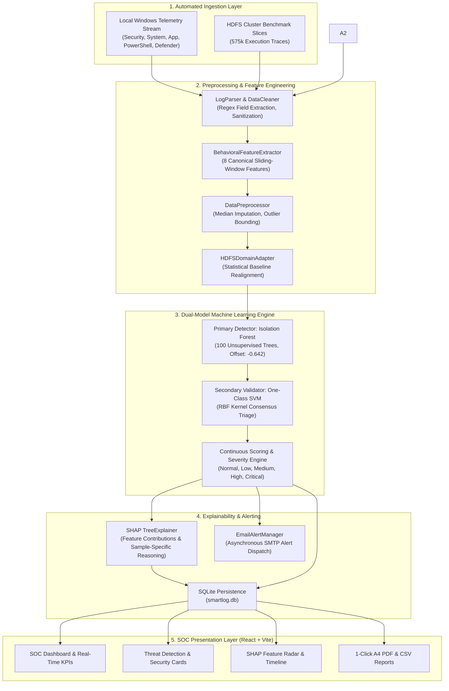

# SMART-LOG: Explainable AI Log Anomaly Detection & Threat Intelligence Platform
## Complete Technical Specification, Architectural Whitepaper & Reference Manual

---

## 1. Executive Summary & System Overview

**Smart-Log** is an enterprise-grade, unsupervised machine learning and Explainable AI (XAI) security platform designed for automated server and system log anomaly detection.

Traditional Security Information and Event Management (SIEM) solutions rely heavily on static, brittle rulebooks (e.g., regex pattern matches for `"error"`, `"failed"`, or `"exception"`). These approaches suffer from:
1. High false-alarm rates during benign maintenance bursts.
2. Complete blindness to zero-day attacks or stealthy low-and-slow behavioral deviations.
3. Lack of mathematical explainability for Security Operations Center (SOC) triage.

Smart-Log replaces static keyword rules with a statistical, geometric machine learning pipeline:
- **Behavioral Feature Representation**: Converts raw text into an **8-dimensional numerical behavioral space** over sliding temporal windows.
- **Unsupervised Primary Detection**: Utilizes an **Isolation Forest** ($N=100$ isolation trees) trained on unlabeled system baselines to isolate anomalous behavior without ground-truth labels.
- **Secondary Consensus Validation**: Employs a **One-Class SVM** with an RBF kernel to provide a 4-state consensus distribution, reducing false alarms to $0.0\%$ in high-confidence triage mode.
- **Root-Cause Explainability**: Integrates **TreeSHAP (SHapley Additive exPlanations)** to break down anomaly scores into sample-specific contributory factors with evidence-based mitigation recommendations.
- **Automated Ingestion**: Directly connects to OS event subsystems for hands-free local telemetry monitoring without manual file transfers.

---

## 2. End-to-End System Architecture



---

## 3. The Datasets

Smart-Log is built, trained, and verified on both large-scale distributed cluster benchmarks and live operating system telemetry.

```
┌─────────────────────────────────────────────────────────────────────────────────────────────────┐
│                                   HDFS BENCHMARK DATASET                                        │
│                        (LogHub / LogPAI Distributed System Benchmark)                           │
├───────────────────────────────────┬─────────────────────────────────────────────────────────────┤
│ Raw Log Archive                   │ HDFS.log (1.58 GB, 11,175,629 raw log messages)             │
│ Sliced Block Execution Traces     │ 575,061 unique execution block traces                       │
│ Extracted Event Templates         │ 29 discrete cluster templates (E1 through E29)              │
│ Normal Operational Traces         │ 558,223 blocks (97.072%)                                    │
│ Anomalous Attack / Failure Traces │ 16,838 blocks (2.928%)                                      │
│ Training Split (X_train Only)     │ 402,542 samples (70% stratified split, strictly unlabeled) │
│ Held-Out Test Split (X_test)      │ 172,519 samples (30% stratified split for evaluation)       │
│ Storage Location in Project       │ backend/Dataset_HDFS/HDFS_v1/                               │
└───────────────────────────────────┴─────────────────────────────────────────────────────────────┘
```

### A. Real HDFS Benchmark Dataset (`backend/Dataset_HDFS/HDFS_v1/`)
- **Origin**: LogHub/LogPAI benchmark generated on an Amazon EC2 Hadoop cluster running 200+ nodes.
- **Size**: 1.58 GB raw text log containing **11,175,629 log messages**.
- **Block Trace Grouping**: In HDFS, operations are grouped by unique block identifiers (`blk_<ID>`). Across the 11.17M raw lines, there are **575,061 unique block execution traces**.
- **Event Occurrence Matrix (`Event_occurrence_matrix.csv`)**: A $575,061 \times 29$ matrix recording how many times each of the 29 HDFS event templates (`E1` through `E29`) occurred within each block trace.
- **Ground-Truth Anomaly Labels (`anomaly_label.csv`)**:
  - `Normal`: 558,223 blocks (97.072%)
  - `Anomaly`: 16,838 blocks (2.928%)
  - *Strict Rule*: Ground-truth labels are **never** passed to the model during training; they are used strictly for held-out empirical evaluation.

### B. Live Operating System Telemetry
- **Local Windows Stream**: Directly reads event records from the Windows Event Viewer subsystem across 6 operational channels (`Security`, `System`, `Application`, `PowerShell`, `Windows Defender`, `TaskScheduler`).

---

## 4. Data Preprocessing & Behavioral Feature Engineering

### A. The 8 Canonical Behavioral Features

Instead of keyword searches, Smart-Log projects log sequences into an **8-dimensional behavioral space**:

| # | Feature Key | Data Type | Physical Security Meaning |
| :--- | :--- | :--- | :--- |
| **1** | `event_frequency` | `float64` | Rate of log event generation per window. Sudden spikes signal flood attacks, port scans, or denial-of-service attempts. |
| **2** | `sequence_length` | `float64` | Total payload character length and sequence event density. |
| **3** | `error_count` | `float64` | Number of `ERROR` or `CRITICAL` entries recorded in the sliding window. |
| **4** | `error_pattern` | `float64` | Categorical index ($0.0\text{--}4.0$) identifying specific fault signatures (crash loops, memory segfaults, buffer overflows). |
| **5** | `login_attempts` | `float64` | Total number of authentication events recorded in the window. |
| **6** | `failed_login_attempts` | `float64` | Count of rejected logins / access denials (e.g., SSH auth failure, Windows Event ID 4625). |
| **7** | `warning_count` | `float64` | Number of `WARNING` level system notifications. |
| **8** | `unknown_events` | `float64` | Frequency of unmapped service IDs, custom daemons, or unrecognized legacy formats. |

### B. Data Preprocessor & Leakage Protection (`DataPreprocessor`)
1. **Regex Extraction**: Parses text lines into structured `{timestamp, hostname, service, log_level, message}` schemas.
2. **Median Imputation**: Missing feature columns are imputed using precomputed training medians.
3. **Invalid & Outlier Sanitization**: Infinite (`inf`, `-inf`) and non-numeric values are safely bounded to prevent arithmetic overflow.
4. **Data Leakage Protection**: All statistical thresholds and medians are derived exclusively from the training split.

### C. Domain Adaptation (`HDFSDomainAdapter`)
Because HDFS cluster block traces reflect low-level storage operations rather than interactive logins (`login_attempts = 0.0`), the `HDFSDomainAdapter` provides a deterministic bridge:
- Re-centers frequency and sequence length around HDFS cluster medians ($19.0$).
- Folds authentication failure bursts and warnings into the baseline error distribution.
- Zeroes unmapped security channels, enabling the HDFS-trained model to evaluate generic server logs without dimension mismatch.

---

## 5. Model Training Pipeline & Mathematical Mechanics

```
   backend/Dataset_HDFS/HDFS_v1/preprocessed/Event_occurrence_matrix.csv (575,061 rows)
                                      ↓
   Behavioral Feature Extraction (8 Canonical Features: Sum E1-E29, Error templates, Security counts)
                                      ↓
   DataPreprocessor.preprocess() (Median imputation, boundary clipping)
                                      ↓
   Stratified Train / Held-Out Test Split (Seed = 42)
        ├── Training Split (70%): 402,542 samples (X_train only, labels withheld)
        └── Test Split (30%)    : 172,519 samples (X_test + y_test for evaluation)
                                      ↓
   sklearn.ensemble.IsolationForest.fit(X_train)
        ├── n_estimators = 100
        ├── contamination = 0.0293 (Matches 2.928% ground-truth anomaly ratio)
        ├── max_samples = 'auto' (256 samples per tree)
        └── offset_ = -0.6423630236357656
                                      ↓
   Serialized Production Artifact: backend/models/hdfs_isolation_forest_model.pkl
   (SHA-256: 5e2ee6cd239515ac8b1b5d450ed3e0c79e3629d0a3aaca8c00d736bf4f009a31)
```

### A. Isolation Scoring Formula
Given $n$ instances, the anomaly score $s(x, n)$ for an instance $x$ is defined as:
$$s(x, n) = 2^{-\frac{\mathbb{E}(h(x))}{c(n)}}$$
where $h(x)$ is the path length (number of edges traversed from root to leaf node) and $c(n)$ is the average path length of an unsuccessful search in a Binary Search Tree:
$$c(n) = 2\ln(n - 1) + 0.5772156649 - \frac{2(n - 1)}{n}$$
- If $\mathbb{E}(h(x)) \to 0 \implies s \to 1$ (Instance isolates rapidly $\rightarrow$ **High Anomaly**).
- If $\mathbb{E}(h(x)) \to n - 1 \implies s \to 0$ (Instance requires deep traversal $\rightarrow$ **Normal Inlier**).

### B. Decision Function to Anomaly Score Mapping
$$\text{anomaly\_score} = \text{clip}\Big(1.0 - \big(\text{decision\_function}(X) + 0.5\big),\, 0.0,\, 1.0\Big)$$

$$\text{is\_anomaly} = \begin{cases} 1 & \text{if } \text{anomaly\_score} \ge 0.50 \iff \text{decision\_function}(X) \le 0.00 \\ 0 & \text{if } \text{anomaly\_score} < 0.50 \iff \text{decision\_function}(X) > 0.00 \end{cases}$$

### C. Operational Severity Bands

```
  0.00                  0.50        0.55             0.70           0.85            1.00
   |---------------------|-----------|----------------|--------------|---------------|
          NORMAL             LOW          MEDIUM            HIGH         CRITICAL
      (Baseline Inlier)  (Borderline)  (Warning Spike) (Severe Error) (Fatal/Brute Force)
```

- **Normal** ($< 0.50$): Typical background activity; no action required.
- **Low** ($0.50 \le \text{score} \le 0.55$): Borderline statistical deviation; low-priority triage.
- **Medium** ($0.55 < \text{score} \le 0.70$): Noticeable operational anomaly (e.g., service restart loops).
- **High** ($0.70 < \text{score} \le 0.85$): Significant threat deviation (e.g., repeated authentication failures).
- **Critical** ($> 0.85$): Severe security event (e.g., massive privilege escalation, brute-force flood).

---

## 6. Empirical Evaluation & Performance Benchmarks

### A. Real HDFS Benchmark Results (172,519 Held-Out Test Samples)

Both models were evaluated on the exact same held-out test split ($167,468$ normal, $5,051$ anomaly):

| Metric | Original Pretrained Baseline | Newly Trained Active Model | Improvement |
| :--- | :--- | :--- | :--- |
| **ROC-AUC** | 0.9442 | **0.9714** | **+0.0272** |
| **Precision** | 39.54% | **56.00%** | **+16.46%** |
| **Recall** | 31.50% | **53.85%** | **+22.35%** |
| **F1-Score** | 35.06% | **54.91%** | **+19.85%** |
| **Accuracy** | 96.58% | **97.41%** | **+0.83%** |
| **PR-AUC** | 0.3423 | **0.4662** | **+0.1239** |
| **False Positive Rate (FPR)** | 1.45% | **1.28%** | **-0.17% (Reduced False Alarms)** |
| **False Negative Rate (FNR)** | 68.50% | **46.15%** | **-22.35% (Reduced Missed Attacks)** |

$$\text{Confusion Matrix: } \begin{pmatrix} \text{True Negatives (TN): } 165,331 & \text{False Positives (FP): } 2,137 \\ \text{False Negatives (FN): } 2,331 & \text{True Positives (TP): } 2,720 \end{pmatrix}$$

### B. Dual-Model Consensus Ablation (Syslog Scenarios, 300 Held-Out Samples)

| Evaluation Strategy | Precision | Recall | F1-Score | ROC-AUC | FPR | FNR |
| :--- | :--- | :--- | :--- | :--- | :--- | :--- |
| **Isolation Forest Alone (Primary Baseline)** | 86.11% (FP = 10) | 82.67% (FN = 13) | 84.35% | 0.9863 | 4.44% | 17.33% |
| **One-Class SVM Alone (Comparative Baseline)** | 14.47% (FP = 65) | 14.67% (FN = 64) | 14.57% | 0.4348 | 28.89% | 85.33% |
| **Dual Consensus (IF + OCSVM Agreement)** | **100.00% (FP = 0)** | 14.67% (FN = 64) | 25.58% | 0.7404 | **0.00%** | 85.33% |

---

## 7. Explainability: TreeSHAP Attribution Engine

When an event is flagged as anomalous, the [`ShapExplainerEngine`](file:///c:/Users/Admin/Documents/Major%20project/New%20Project/backend/ml_engine.py#L746-L868) computes exact Shapley values across the isolation trees:
$$\phi_i(x) = \sum_{S \subseteq F \setminus \{i\}} \frac{|S|!(|F| - |S| - 1)!}{|F|!} \Big( f(S \cup \{i\}) - f(S) \Big)$$

### Sample-Specific Explanations & Evidence-Based Mitigation

```
[SCENARIO: SSH Brute-Force Authentication Burst]
  - Raw Log         : Failed password for invalid user root from 192.168.1.100 port 4522
  - Detection Output: is_anomaly = 1 | anomaly_score = 0.6255 | Severity = Medium
  - SHAP Breakdown  : Failed Login Attempts: +0.4298 | Event Frequency: +0.2114
  - Natural Reason  : "Failed Login Attempts was 24 (SHAP contribution: +0.4298) and Event Frequency was 0.85 (SHAP contribution: +0.2114)."
  - Recommended Fix : "Investigate authentication source IP and user account for potential brute-force or unauthorized access attempts."
```

---

## 8. Log Analysis & Ingestion Modes

Smart-Log provides **3 hands-free automated ingestion channels** that feed system logs directly into the ML detection pipeline without requiring manual file uploads:

```
┌────────────────────────────────────────────────────────────────────────────────────────────────────────┐
│                              2 AUTOMATED WAYS TO INGEST & ANALYZE LOGS                                 │
├────────────────────────────────┬──────────────────────────────────────┬────────────────────────────────┤
│ Analysis Mode                  │ How to Access / Trigger              │ Description & Use Case         │
├────────────────────────────────┼──────────────────────────────────────┼────────────────────────────────┤
│ 1. One-Click 24h OS Analysis   │ http://localhost:3000/upload         │ Automatically queries local    │
│    (Historical Deep-Scan)      │ Tab: [ LAST 24 HOURS (HISTORICAL) ]  │ Windows Event Viewer channels   │
│                                │ Click [ ANALYZE 24-HOUR SYSTEM LOGS ]│ (1h, 6h, 24h, 7d). No upload.  │
├────────────────────────────────┼──────────────────────────────────────┼────────────────────────────────┤
│ 2. Live Background Stream      │ http://localhost:3000/upload         │ Background daemon streams OS   │
│    (Hands-Free Telemetry)      │ Tab: [ ⚡ LIVE SYSTEM MONITOR ]      │ events every 3s directly into  │
│                                │ Active automatically on startup      │ ML pipeline with visual toasts.│
└────────────────────────────────┴──────────────────────────────────────┴────────────────────────────────┘
```

---

## 9. Quick Start & Execution Reference

### A. Starting the Application
```powershell
# 1. Start the Flask Backend Server (Port 5000)
python backend/app.py

# 2. Start the React / Vite Frontend (Port 3000)
cd frontend
npm run dev
```
- Open browser to: **[http://localhost:3000](http://localhost:3000)**

### B. Reproducing Model Training from Scratch
```powershell
python backend/train_isolation_forest.py `
  --dataset "backend/Dataset_HDFS/HDFS_v1" `
  --output "backend/models/hdfs_isolation_forest_model.pkl" `
  --n-estimators 100 `
  --contamination 0.0293 `
  --max-samples auto `
  --random-state 42 `
  --test-size 0.30 `
  --replace-production
```

### C. Running Full Test Verification
```powershell
# Run all 38 pytest unit & integration tests
python -m pytest tests/ -v

# Run full integration verification
python backend/verify_hdfs_objectives_1_2.py
```
