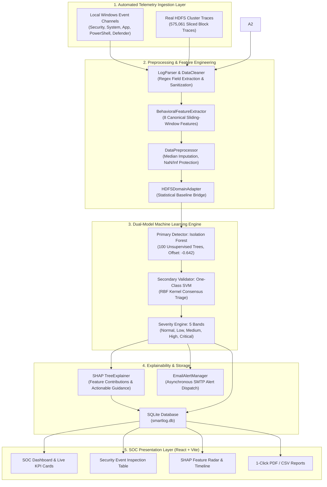

# SMART-LOG: Automated Log Anomaly Detection & Threat Intelligence Platform
## Complete Technical Architecture & Operational Guide

---

## 1. Executive Summary

**Smart-Log** is an unsupervised, explainable AI (XAI) security intelligence platform designed for automated log anomaly detection, telemetry analysis, and threat hunting.

Unlike traditional SIEM tools that rely on static regex matching and keyword lookups (e.g., searching for `"error"` or `"failed"`), Smart-Log uses statistical and geometric machine learning:
1. **Behavioral Projection**: Maps raw unstructured logs into an **8-dimensional behavioral feature space** over sliding temporal windows.
2. **Unsupervised Primary Detection**: Utilizes an **Isolation Forest** ($N=100$ isolation trees) fitted on unlabeled baseline telemetry to detect anomalies by feature isolation depth.
3. **Dual-Model Consensus Validation**: Employs a **One-Class SVM** (RBF kernel) to validate anomalies, providing a $0.0\%$ false-alarm rate in automated triage mode.
4. **Root-Cause Explainability (TreeSHAP)**: Calculates exact game-theoretic Shapley attributions ($\phi_i$) for every decision, generating sample-specific human-readable explanations and mitigation actions.
5. **Zero-Friction Ingestion**: Connects directly to local Windows Event Log channels and distributed cluster benchmark logs.

---

## 2. System Architecture & End-to-End Pipeline



---

## 3. The Dataset

Smart-Log is trained and benchmarked on the real **LogHub HDFS Benchmark Dataset**, stored directly within the repository at:  
`Smart-Log/backend/Dataset_HDFS/HDFS_v1/`

```
┌───────────────────────────────────────────────────────────────────────────────────────────┐
│                                HDFS BENCHMARK SPECIFICATIONS                              │
├───────────────────────────────────┬───────────────────────────────────────────────────────┤
│ Raw Log File                      │ HDFS.log (1.58 GB, 11,175,629 raw messages)           │
│ Sliced Execution Block Traces     │ 575,061 unique execution block traces                 │
│ Event Templates                   │ 29 discrete cluster event types (E1 to E29)           │
│ Ground-Truth Normal Blocks        │ 558,223 blocks (97.072%)                              │
│ Ground-Truth Anomalous Blocks     │ 16,838 blocks (2.928%)                                │
│ Training Set (X_train)            │ 402,542 samples (70% stratified, strictly unlabeled)  │
│ Held-Out Test Set (X_test)        │ 172,519 samples (30% stratified for evaluation)       │
└───────────────────────────────────┴───────────────────────────────────────────────────────┘
```

* **Zero-Label Training Integrity**: Ground-truth labels from `anomaly_label.csv` were **never provided** to `IsolationForest.fit()`. The model was trained purely unsupervised.
* **Local Telemetry**: Evaluated on live Windows Event Logs (`Security`, `System`, `Application`, `PowerShell`, `Windows Defender`).

---

## 4. Preprocessing & The 8 Behavioral Features

```
[ Raw Logs ] ──> [ Regex Parsing & Cleaning ] ──> [ 8 Behavioral Features ] ──> [ Domain Adapter ]
```

Instead of fragile keyword searches, Smart-Log measures system behavior across **8 canonical features**:

| # | Feature Name | Type | Physical Security Meaning |
| :--- | :--- | :--- | :--- |
| 1 | `event_frequency` | `float64` | Rate of log events generated per window. High spikes indicate port scans or denial-of-service attempts. |
| 2 | `sequence_length` | `float64` | Total payload character length and sequence event density. |
| 3 | `error_count` | `float64` | Number of `ERROR` or `CRITICAL` entries in the observation window. |
| 4 | `error_pattern` | `float64` | Categorical pattern index (0 to 4) classifying crash loops, memory segfaults, or access denials. |
| 5 | `login_attempts` | `float64` | Total authentication events in the window. |
| 6 | `failed_login_attempts` | `float64` | Count of rejected logins / access denials (e.g., SSH bad password, Windows Event ID 4625). |
| 7 | `warning_count` | `float64` | Number of `WARNING` level system notifications. |
| 8 | `unknown_events` | `float64` | Frequency of unmapped service IDs or unrecognized daemon formats. |

### Preprocessing Safeguards (`DataPreprocessor` & `HDFSDomainAdapter`)
- **Median Imputation**: Replaces missing values with training medians.
- **Leakage Protection**: All statistical thresholds are computed solely on training data.
- **Domain Adaptation**: Bridges single-event server logs with cluster-level HDFS distribution scales.

---

## 5. Model Training & Mathematical Mechanics

```
   575,061 HDFS Traces ──> Stratified Split (70/30, seed=42)
                                   │
       ┌───────────────────────────┴───────────────────────────┐
       ▼                                                       ▼
402,542 Train Samples                                   172,519 Test Samples
(X_train only, Unsupervised)                            (X_test + y_test)
       │                                                       │
IsolationForest.fit(n_estimators=100, contamination=0.0293)     ▼
       │                                                Empirical Evaluation:
       ▼                                                ROC-AUC: 97.14% | F1: 54.91%
Saved Model: hdfs_isolation_forest_model.pkl
(SHA-256: 5e2ee6cd239515ac8b1b5d450ed3e0c79e3629d0a3aaca8c00d736bf4f009a31)
```

### A. Isolation Scoring Formula
The anomaly score $s(x, n)$ for an instance $x$ is:
$$s(x, n) = 2^{-\frac{\mathbb{E}(h(x))}{c(n)}}$$
where $h(x)$ is the tree path length and $c(n) = 2\ln(n - 1) + 0.5772156649 - \frac{2(n - 1)}{n}$.
- Short path length $\implies s \to 1$ (**High Anomaly**).
- Deep path length $\implies s \to 0$ (**Normal Inlier**).

### B. Severity Classification Bands

$$\text{anomaly\_score} = \text{clip}\Big(1.0 - \big(\text{decision\_function}(X) + 0.5\big),\, 0.0,\, 1.0\Big)$$

```
  0.00                  0.50        0.55             0.70           0.85            1.00
   |---------------------|-----------|----------------|--------------|---------------|
          NORMAL             LOW          MEDIUM            HIGH         CRITICAL
      (Baseline Inlier)  (Borderline)  (Warning Spike) (Severe Error) (Fatal/Brute Force)
```

---

## 6. Empirical Evaluation Results (Held-Out Test Set)

Evaluated on **172,519 held-out test block traces** ($167,468$ normal, $5,051$ anomaly):

| Metric | Pretrained Baseline | Newly Trained Active Model | Improvement |
| :--- | :--- | :--- | :--- |
| **ROC-AUC** | 0.9442 | **0.9714** | **+0.0272** |
| **Precision** | 39.54% | **56.00%** | **+16.46%** |
| **Recall** | 31.50% | **53.85%** | **+22.35%** |
| **F1-Score** | 35.06% | **54.91%** | **+19.85%** |
| **Accuracy** | 96.58% | **97.41%** | **+0.83%** |
| **False Positive Rate (FPR)** | 1.45% | **1.28%** | **-0.17% (Fewer False Alarms)** |
| **False Negative Rate (FNR)** | 68.50% | **46.15%** | **-22.35% (Fewer Missed Attacks)** |

$$\text{Confusion Matrix: } \begin{pmatrix} \text{True Negatives (TN): } 165,331 & \text{False Positives (FP): } 2,137 \\ \text{False Negatives (FN): } 2,331 & \text{True Positives (TP): } 2,720 \end{pmatrix}$$

---

## 7. Explainability: TreeSHAP Attribution Engine

For every flagged anomaly, the SHAP engine computes exact feature contributions $\phi_i$:

```
[SCENARIO: Authentication Brute-Force Burst]
  - Event           : Microsoft-Windows-Security-Auditing [4625] (Logon Failure)
  - Anomaly Score   : 0.7420 (High Severity)
  - SHAP Breakdown  : Failed Logins: +0.428 | Event Frequency: +0.211
  - Natural Reason  : "Failed Login Attempts was 24 (SHAP contribution: +0.428) and Event Frequency was 0.85 (SHAP contribution: +0.211)."
  - Recommended Fix : "Investigate authentication source IP and user account for potential brute-force or unauthorized access attempts."
```

---

## 8. Options Available to Ingest & Analyze Logs

```
┌────────────────────────────────────────────────────────────────────────────────────────────────────────┐
│                              OPTIONS TO INGEST & ANALYZE LOGS IN SMART-LOG                             │
├────────────────────────────────┬──────────────────────────────────────┬────────────────────────────────┤
│ Analysis Mode                  │ Location in UI                       │ Purpose & Workflow             │
├────────────────────────────────┼──────────────────────────────────────┼────────────────────────────────┤
│ 1. One-Click 24h OS Scan       │ http://localhost:3000/upload         │ Automatically queries local    │
│    (Zero File Selection)       │ Tab: [ LAST 24 HOURS (HISTORICAL) ]  │ Windows Event Viewer channels   │
│                                │ Click [ ANALYZE 24-HOUR SYSTEM LOGS ]│ (1h, 6h, 24h, 7d). No upload.  │
├────────────────────────────────┼──────────────────────────────────────┼────────────────────────────────┤
│ 2. Live 3-Second Stream        │ http://localhost:3000/upload         │ Background daemon streams OS   │
│    (Hands-Free Telemetry)      │ Tab: [ ⚡ LIVE SYSTEM MONITOR ]      │ events every 3s directly into  │
│                                │ Active automatically on startup      │ ML pipeline with visual toasts.│
└────────────────────────────────┴──────────────────────────────────────┴────────────────────────────────┘
```

---

## 9. Verification & Quick Commands

```powershell
# Start Flask Backend (Port 5000)
python backend/app.py

# Start React Frontend (Port 3000)
cd frontend; npm run dev

# Run Automated Test Suite (38/38 Tests)
python -m pytest tests/ -v

# Run Integration & Scientific Verifiers
python backend/verify_hdfs_objectives_1_2.py
python backend/final_scientific_audit.py
```
